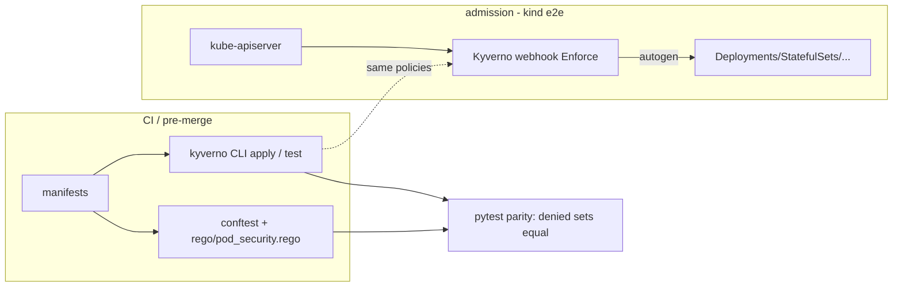

# K8s Policy Pack — 6 Pod Security controls in Kyverno **and** OPA/Rego, with a parity test

> **Lab project.** Tested with the Kyverno CLI and conftest (no cluster). The kind admission test is written and wired into CI but **has not run locally** (no Docker). 

## Problem
Pod Security Standards say *what* a safe pod looks like. Platform teams still have to choose an engine (Kyverno admission vs OPA/Gatekeeper/conftest in CI) and keep the rules consistent. I wrote the same 6 controls twice and **test that both engines deny exactly the same bad pods**. That showed where they differ.

| Control | PSS level | Kyverno | Rego |
|---|---|---|---|
| No privileged containers | baseline | `disallow-privileged` | ✔ |
| runAsNonRoot | restricted | `require-run-as-non-root` | ✔ |
| No `:latest` / untagged images | best practice | `disallow-latest-tag` | ✔ (last path segment) |
| CPU/mem requests + mem limit | best practice | `require-limits` | ✔ |
| No hostNetwork/PID/IPC, no hostPath | baseline | `disallow-host-namespaces-and-paths` | ✔ |
| allowPrivilegeEscalation=false + drop ALL | restricted | `require-drop-all-capabilities` | ✔ |

## Architecture


## Run
```bash
kyverno test tests                     # 48-cell expectation matrix (6 policies x 8 pods)
conftest verify -p rego                # 9 Rego unit tests
conftest test -p rego tests/resources/
pip install pytest pyyaml && pytest -q tests   # parity + sanity + known-gap tests
./kind/e2e.sh                          # needs docker, kind, helm, kubectl
```

## Results (actual runs, 2026-10-11, Kyverno CLI 1.19.1, conftest 0.71.1)
- `kyverno test`: **48/48** expectations met. Each of the 7 bad pods fails exactly its own policy and passes the other 5. The good pod passes all 6.
- `kyverno apply` on all pods: **41 pass / 7 fail**, and the 7 failures are the 7 intended pods (`results/kyverno-apply.txt`).
- `conftest verify`: **9/9**. `conftest test` (`results/conftest.txt`) denies the same 7 pods (11 messages, because some pods break several Rego sub-checks) plus the Deployment.
- `pytest`: **6/6**. Includes a **mutation sanity test**: flipping one expectation must turn `kyverno test` red. This guards against a matrix that passes vacuously.
- **Finding:** the classic Kyverno pattern `image: "*:* & !*:latest"` **accepts `registry.local:5000/legacy-api`** (untagged) because the registry port supplies the `:`. The Rego rule checks only the last path segment and denies it. This is pinned by `test_known_gap_registry_port_untagged`.
- Kyverno autogen: Pod-only policies also denied the bad Deployment (4 rules). That confirms you don't need to duplicate rules per controller.

## Limitations
- **Not run:** live admission on kind (`kind/e2e.sh`, CI job `kind-e2e`).
- Kyverno 1.19 warns that `kyverno.io/v1 ClusterPolicy` is deprecated in favour of CEL `ValidatingPolicy`. Migration is future work.
- No ephemeralContainers, seccomp or AppArmor checks yet. No exceptions/PolicyException workflow yet.
- The latest-tag gap in Kyverno isn't fixed (deliberately left as a documented finding). The fix is a JMESPath deny on the last segment, or using the Rego result.

## Sources
- Kubernetes Pod Security Standards — https://kubernetes.io/docs/concepts/security/pod-security-standards/
- Kyverno CLI test — https://kyverno.io/docs/kyverno-cli/usage/test/ ; autogen — https://kyverno.io/docs/writing-policies/autogen/
- Kyverno policy library — https://kyverno.io/policies/
- conftest — https://www.conftest.dev/

## Related work

This is my own implementation. Ideas came from [amirhosssein0/ai-platform-lab](https://github.com/amirhosssein0/ai-platform-lab) and the Kyverno/PSS sample policies.
